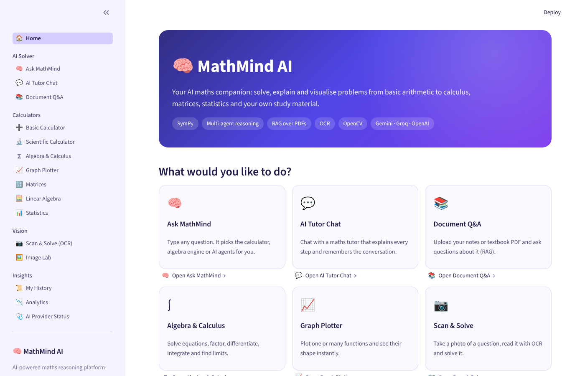
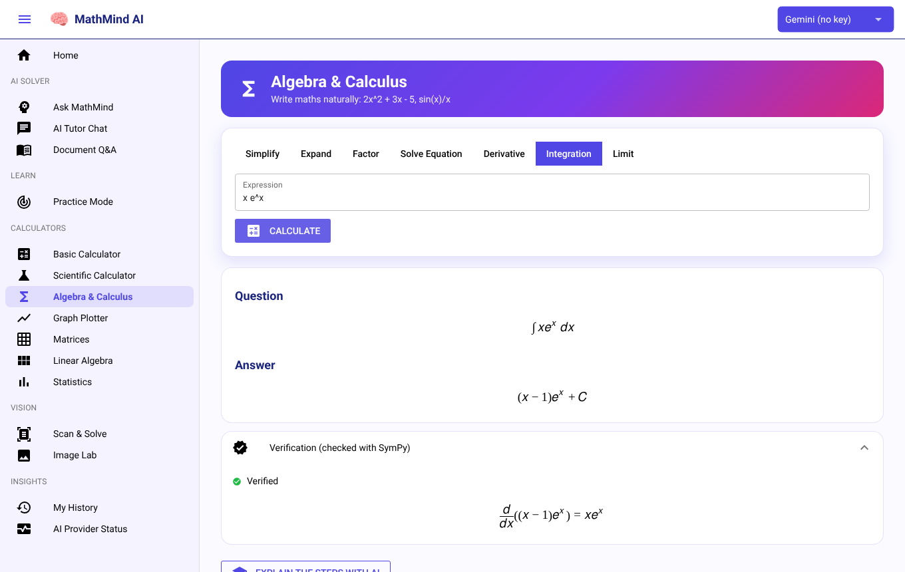
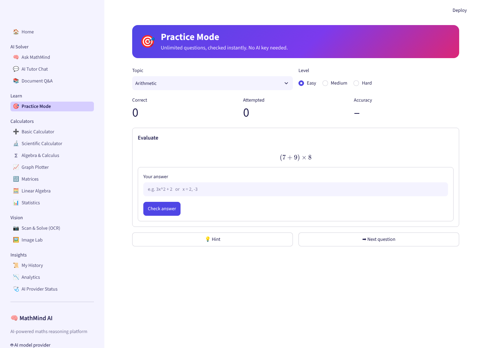
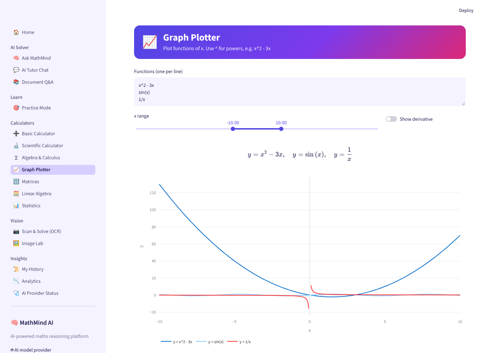
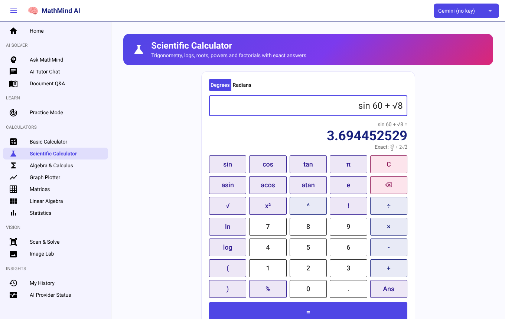
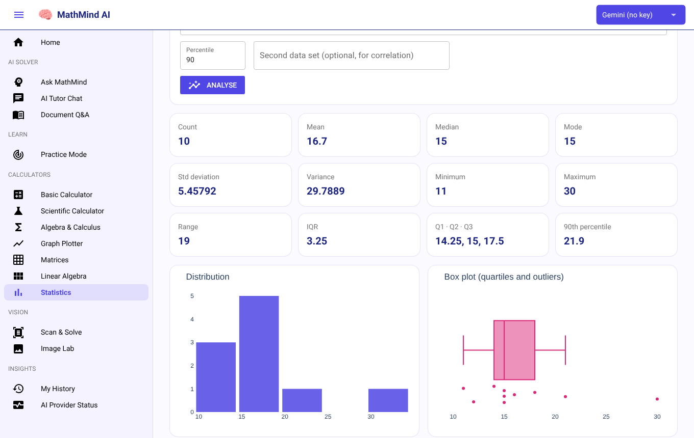
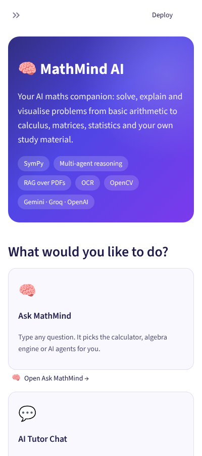
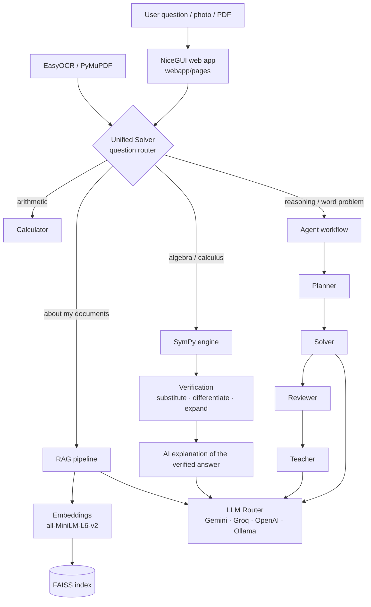

# 🧠 MathMind AI

**An AI-powered maths learning and reasoning platform.** MathMind solves, verifies, explains and visualises maths problems, from basic arithmetic to calculus, matrices and statistics. It can also answer questions from your own study material.

[](https://github.com/DevanshBCA25/MathMind-AI/actions/workflows/tests.yml)


[](https://github.com/DevanshBCA25/MathMind-AI/actions/workflows/deploy-hf.yml)

**Live demo:** _link goes here once deployed (see [Deploy](#-deploy-on-render-free-easiest))._

The web interface is written entirely in Python with [NiceGUI](https://nicegui.io) (Vue/Quasar under the hood), so every page is a real web app: no full-page reruns, instant updates, and it works well on phones.



---

## ✨ Highlights

- **Verified answers.** Every symbolic answer is checked with SymPy: solutions are substituted back, integrals are differentiated, and factorisations are expanded. The AI only *explains* an answer that has already been verified, so it cannot change the result.
- **One box for everything.** *Ask MathMind* reads your question and sends it to the right engine: calculator, algebra, your documents (RAG) or a team of AI agents.
- **Multi-agent reasoning.** Four agents, Planner → Solver → Reviewer → Teacher, plan, solve, check and teach a problem.
- **Learn by doing.** *Practice Mode* generates unlimited questions at three levels and checks your answers instantly, with no AI key needed.
- **Scan & Solve.** Take a photo of a question. OCR reads it, and MathMind solves it.
- **Chat with your notes.** Upload PDFs and ask questions about them, with page-level sources (FAISS + sentence-transformers).
- **Several AI providers.** Gemini, Groq, OpenAI, or a local Ollama, all chosen from one selector in the top bar.
- **Real calculators.** On-screen keypads with exact answers (√8 = 2√2, sin 60° = √3/2) as well as decimals.

## 📸 Screenshots

| Algebra & Calculus (verified) | Practice Mode |
|---|---|
|  |  |

| Interactive graphs | Scientific calculator |
|---|---|
|  |  |

| Statistics with charts | Mobile |
|---|---|
|  |  |

## 🧩 Features

| Section | Page | What it does |
|---|---|---|
| **AI Solver** | Ask MathMind | Routes any question to the best engine and shows the agent steps |
| | AI Tutor Chat | Step-by-step tutor that remembers the conversation; export the chat |
| | Document Q&A | RAG over your PDFs: upload, build a FAISS index, ask with similarity or MMR retrieval, see page-level sources |
| **Learn** | Practice Mode | Arithmetic, linear and quadratic equations, derivatives and integrals, with hints and a score |
| **Calculators** | Basic / Scientific | Keypad calculators: type or tap whole expressions; trig in degrees or radians, logs, roots, factorials, `Ans`; exact and decimal answers |
| | Algebra & Calculus | Simplify, expand, factor, solve, differentiate, integrate and take limits, with LaTeX output, rules used, verification and an AI explanation |
| | Graph Plotter | Plotly graphs with zoom and hover, several functions, derivative curves, and breaks at asymptotes |
| | Matrices / Linear Algebra | Results in matrix notation: determinant, inverse, rank, eigenvalues (as exact surds when possible), LU/QR/SVD, and symmetric, orthogonal and positive-definite checks |
| | Statistics | All summary statistics at once, histogram and box plot, percentiles, correlation, z-scores and normalisation |
| **Vision** | Scan & Solve | Photo (camera on phones) or PDF; uses the PDF's own text when it has one, EasyOCR otherwise; edit the text, then solve |
| | Image Lab | OpenCV filters, thresholds, edges, morphology, contours and histograms, side by side; works on a built-in sample image too |
| **Insights** | My History | Everything you did, saved in your browser: counts per tool, search, CSV download |
| | AI Provider Status | Which AI providers are configured and ready |

## 🏗️ Architecture



## 🗂️ Project structure

```text
MathMind-AI/
├── main.py                 # Entry point: python main.py → http://localhost:7860
├── webapp/                 # NiceGUI web interface
│   ├── layout.py           # Header, navigation drawer, theme, model selector
│   ├── state.py            # Per-visitor history, chat and settings (browser storage)
│   ├── widgets.py          # Maths rendering (LaTeX → MathML) and small UI pieces
│   └── pages/              # One module per page (@ui.page routes)
├── src/
│   ├── calculator/         # Basic, scientific, symbolic, graph, matrix, stats,
│   │                       # steps.py (verification), practice.py (quiz)
│   ├── core/               # unified_solver.py: question router
│   ├── agents/             # Planner, Solver, Reviewer, Teacher
│   ├── llm/                # Provider clients + router
│   ├── rag/                # Loader, chunking, embeddings, FAISS, retrieval, evaluation
│   ├── ocr/  vision/       # EasyOCR, PDF rendering, OpenCV utilities
│   ├── api/                # FastAPI endpoints (/api/calculator, /api/rag, /api/agent)
│   └── tests/              # pytest suite
├── data/documents/         # Sample PDFs for RAG
├── docs/screenshots/
├── .github/workflows/      # tests.yml (CI) · deploy-hf.yml (Hugging Face deploy)
├── Dockerfile  docker-compose.yml
└── requirements.txt
```

## 🚀 Run it locally

```bash
git clone https://github.com/DevanshBCA25/MathMind-AI.git
cd MathMind-AI
python -m venv .venv
# Windows: .venv\Scripts\activate    macOS/Linux: source .venv/bin/activate
pip install -r requirements.txt
cp .env.example .env        # then add at least one API key
python main.py              # open http://localhost:7860
```

The calculators, graphs and Practice Mode work without any API key. The AI pages need a key for at least one provider:

| Provider | Variable | Free key |
|---|---|---|
| Gemini | `GEMINI_API_KEY` | https://aistudio.google.com/apikey |
| Groq | `GROQ_API_KEY` | https://console.groq.com/keys |
| OpenAI | `OPENAI_API_KEY` | (paid) |
| Ollama | `OLLAMA_BASE_URL` | Local only, no key |

**Docker:**

```bash
docker compose up --build    # http://localhost:7860
```

**REST API:**

```bash
uvicorn src.api.app:app --reload    # docs at http://localhost:8000/docs
```

## ☁️ Deploy on Render (free, easiest)

`render.yaml` sets everything up. Render's free server has 512 MB of memory, so it installs the lighter `requirements-render.txt`. On Render, Scan & Solve reads PDFs that contain real text (no OCR on photos), and Document Q&A uses Gemini embeddings. Everything else works fully.

1. Sign in at [render.com](https://render.com) with GitHub. No card is needed.
2. Click **New → Blueprint**, pick this repository, and click **Apply**.
3. When it asks for `GEMINI_API_KEY`, paste your key ([free key](https://aistudio.google.com/apikey)). `GROQ_API_KEY` is optional.
4. Wait for the first build (about 5 to 10 minutes). The app is then live at `https://mathmind-ai-xxxx.onrender.com`.

Every push to `main` redeploys. A free Render app sleeps after 15 minutes without visitors and takes about a minute to wake up.

## ☁️ Deploy to Hugging Face Spaces (free, full features)

The app runs on a free Hugging Face Space (Docker, 2 vCPU, 16 GB RAM), which has room for OCR and the embedding model. Every push to `main` deploys automatically through `.github/workflows/deploy-hf.yml`.

One-time setup:

1. Create an account at [huggingface.co](https://huggingface.co/join).
2. Create a Space: **New → Space**, name it `mathmind-ai`, choose **Docker → Blank**, hardware **CPU basic (free)**, visibility **Public**.
3. In the Space, open **Settings → Variables and secrets** and add the secrets `GEMINI_API_KEY` (and any other provider keys) and `STORAGE_SECRET` (any long random text).
4. Create a token at [huggingface.co/settings/tokens](https://huggingface.co/settings/tokens) with the **Write** role.
5. In this GitHub repository, open **Settings → Secrets and variables → Actions**:
   - **Secrets** tab: add `HF_TOKEN` = the token from step 4.
   - **Variables** tab: add `HF_SPACE` = `your-hf-username/mathmind-ai`.
6. Open **Actions → Deploy to Hugging Face Spaces → Run workflow** (or push to `main`).

The first build takes about 10 minutes. The app is then live at `https://your-hf-username-mathmind-ai.hf.space`.

## 🧪 Tests

```bash
pip install pytest
pytest
```

GitHub Actions runs the test suite on every push and pull request.

## 🛠️ Tech stack

Python · NiceGUI · SymPy · NumPy · SciPy · pandas · Plotly · Matplotlib · OpenCV · EasyOCR · PyMuPDF · LangChain · FAISS · sentence-transformers · Gemini / Groq / OpenAI / Ollama · FastAPI · Docker · Hugging Face Spaces · pytest · GitHub Actions

## ⚠️ Limitations

- OCR works best on printed text. Handwriting and complex notation (fractions, matrices) may need editing before you solve.
- LLM explanations can be wrong. That is why symbolic answers are verified with SymPy, and the AI only explains them.
- The first OCR or RAG run downloads models and takes longer. A free Space also sleeps after 48 hours without visitors and takes a minute to wake up.
- History, chat and practice score are saved per browser on the server; uploaded documents last until the server restarts.

## 🔭 Future scope

- Handwritten maths recognition (e.g. LaTeX-OCR)
- Tool-calling agents (LangGraph) that call the calculator or SymPy themselves
- User accounts with saved history and progress
- Hindi / Hinglish explanations
- Accuracy benchmark comparing providers on a fixed question set

## 👤 Author

**Devansh**, BCA final-year project · [GitHub](https://github.com/DevanshBCA25)
