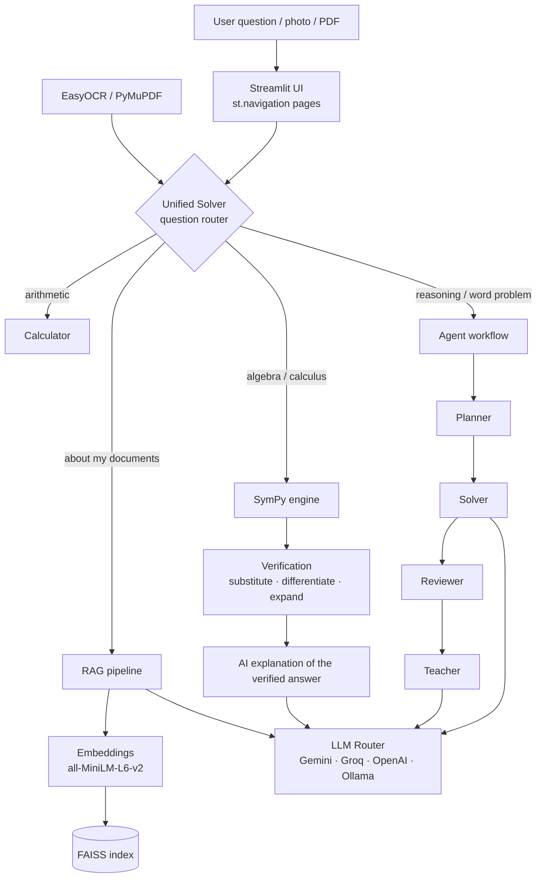

# 🧠 MathMind AI

**An AI-powered maths learning and reasoning platform.** MathMind solves, verifies, explains and visualises maths problems, from basic arithmetic to calculus, matrices and statistics. It can also answer questions from your own study material.

[](https://github.com/DevanshBCA25/MathMind-AI/actions/workflows/tests.yml)


**Live demo:** https://mathmind-ai-devansh.streamlit.app/


---

## ✨ Highlights

- **Verified answers.** Every symbolic answer is checked with SymPy: solutions are substituted back, integrals are differentiated, and factorisations are expanded. The AI only *explains* an answer that has already been verified, so it cannot change the result.
- **One box for everything.** *Ask MathMind* reads your question and sends it to the right engine: calculator, algebra, your documents (RAG) or a team of AI agents.
- **Multi-agent reasoning.** Four agents, Planner → Solver → Reviewer → Teacher, plan, solve, check and teach a problem.
- **Learn by doing.** *Practice Mode* generates unlimited questions at three levels and checks your answers instantly, with no AI key needed.
- **Scan & Solve.** Take a photo of a question. OCR reads it, and MathMind solves it.
- **Chat with your notes.** Upload PDFs and ask questions about them, with page-level sources (FAISS + sentence-transformers).
- **Several AI providers.** Gemini, Groq, OpenAI, or a local Ollama, all chosen from one selector in the sidebar.

## 📸 Screenshots

| Algebra & Calculus (verified) | Practice Mode |
|---|---|
|  |  |

| Interactive graphs | Mobile |
|---|---|
|  |  |

## 🧩 Features

| Section | Page | What it does |
|---|---|---|
| **AI Solver** | Ask MathMind | Routes any question to the best engine and shows the agent steps |
| | AI Tutor Chat | Step-by-step tutor that remembers the conversation; export the chat |
| | Document Q&A | RAG over your PDFs: similarity or MMR retrieval, sources, confidence, evaluation dashboard |
| **Learn** | Practice Mode | Arithmetic, linear and quadratic equations, derivatives and integrals, with hints and a score |
| **Calculators** | Basic / Scientific | Arithmetic, powers, roots and trigonometry, with friendly errors |
| | Algebra & Calculus | Simplify, expand, factor, solve, differentiate, integrate and take limits, with LaTeX output, rules used, verification and an AI explanation |
| | Graph Plotter | Plotly graphs with zoom and hover, several functions, derivative curves, and breaks at asymptotes |
| | Matrices / Linear Algebra | Determinant, inverse, rank, eigenvalues, LU/QR/SVD, and symmetric, orthogonal and positive-definite checks |
| | Statistics | Mean, median, mode, variance, quartiles, IQR, z-scores and normalisation |
| **Vision** | Scan & Solve | Camera or upload, EasyOCR on images and PDFs, then solve |
| | Image Lab | OpenCV filters, thresholds, edges, morphology, contours and histograms |
| **Insights** | My History | Your work in this session; download as CSV |
| | Analytics / AI Provider Status | Usage metrics, and which providers are configured |

## 🏗️ Architecture



## 🗂️ Project structure

```text
MathMind-AI/
├── app.py                  # Entry point: navigation, theme, provider selector
├── assets/style.css        # Custom styling
├── src/
│   ├── ui/                 # One module per page (+ pages.py registry, common.py)
│   ├── calculator/         # Basic, scientific, symbolic, graph, matrix, stats,
│   │                       # steps.py (verification), practice.py (quiz)
│   ├── core/               # unified_solver.py: question router
│   ├── agents/             # Planner, Solver, Reviewer, Teacher
│   ├── llm/                # Provider clients + router
│   ├── rag/                # Loader, chunking, embeddings, FAISS, retrieval, evaluation
│   ├── ocr/  vision/       # EasyOCR, PDF rendering, OpenCV utilities
│   ├── api/                # FastAPI endpoints (/api/calculator, /api/rag, /api/agent)
│   └── tests/              # pytest suite
├── data/documents/         # Sample PDFs for RAG
├── docs/screenshots/
├── Dockerfile  docker-compose.yml
└── requirements.txt
```

## 🚀 Run it locally

```bash
git clone https://github.com/DevanshBCA25/MathMind-AI.git
cd MathMind-AI
python -m venv .venv
# Windows: .venv\Scripts\activate    macOS/Linux: source .venv/bin/activate
pip install -r requirements.txt
cp .env.example .env        # then add at least one API key
streamlit run app.py
```

The calculators, graphs and Practice Mode work without any API key. The AI pages need a key for at least one provider:

| Provider | Variable | Free key |
|---|---|---|
| Gemini | `GEMINI_API_KEY` | https://aistudio.google.com/apikey |
| Groq | `GROQ_API_KEY` | https://console.groq.com/keys |
| OpenAI | `OPENAI_API_KEY` | (paid) |
| Ollama | `OLLAMA_BASE_URL` | Local only, no key |

**Streamlit Cloud:** add the same keys under *App → Settings → Secrets*, for example `GEMINI_API_KEY = "..."`.

**Docker:**

```bash
docker compose up --build    # http://localhost:8501
```

**REST API:**

```bash
uvicorn src.api.app:app --reload    # docs at http://localhost:8000/docs
```

## 🧪 Tests

```bash
pip install pytest
pytest
```

GitHub Actions runs the test suite on every push and pull request.

## 🛠️ Tech stack

Python · Streamlit · SymPy · NumPy · SciPy · pandas · Plotly · Matplotlib · OpenCV · EasyOCR · PyMuPDF · LangChain · FAISS · sentence-transformers · Gemini / Groq / OpenAI / Ollama · FastAPI · Docker · pytest · GitHub Actions

## ⚠️ Limitations

- OCR works best on printed text. Handwriting and complex notation (fractions, matrices) may need editing before you solve.
- LLM explanations can be wrong. That is why symbolic answers are verified with SymPy, and the AI only explains them.
- The free Streamlit Cloud tier has limited memory. The first OCR or RAG run downloads models and takes longer.
- History and uploaded documents last only for your browser session.

## 🔭 Future scope

- Handwritten maths recognition (e.g. LaTeX-OCR)
- Tool-calling agents (LangGraph) that call the calculator or SymPy themselves
- User accounts with saved history and progress
- Hindi / Hinglish explanations
- Accuracy benchmark comparing providers on a fixed question set

## 👤 Author

**Devansh**, BCA final-year project · [GitHub](https://github.com/DevanshBCA25)
